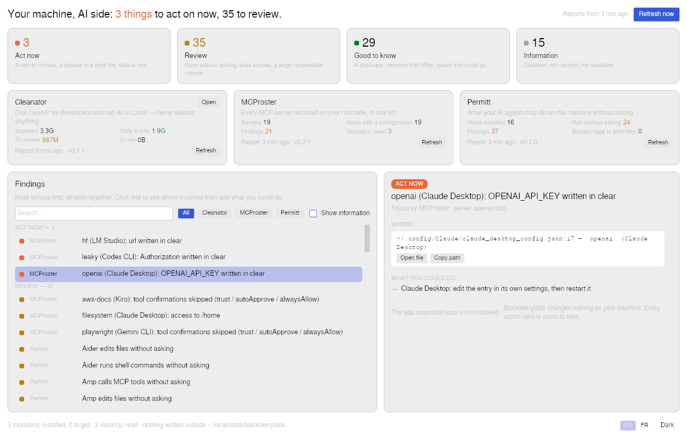

# Blackberrylabs

**Read-only tools that show what AI coding agents do to your machine — and one screen that
gathers them.**



Blackberrylabs is a small family of desktop tools for developers and vibe coders who run AI
on Linux. Each tool answers one question about your machine and never acts in your place.
**Want one of them? Install it, it is complete on its own. Want several? Install the tower,
then pick the modules you need: it works with any subset and shows the others as available.**

| Module | Verb | What it answers |
|---|---|---|
| [Permitt](https://github.com/blackberrylabs/permitt) | inspect | What each AI assistant may do without asking, and which setting says so |
| [MCProster](https://github.com/blackberrylabs/mcproster) | inventory | Every MCP server declared on the machine, once, with what is wrong |
| [Cleanator](https://github.com/blackberrylabs/cleanator) | clean | What AI tooling left on the disk, and what could go |
| [Linstruct](https://github.com/blackberrylabs/linstruct) | lint | Your AI instruction files (CLAUDE.md, AGENTS.md, .cursor/rules…) as each agent will actually read them, and what it silently drops |
| [Billfold](https://github.com/blackberrylabs/billfold) | tally | The accounts the machine is wired to, the keys it holds, the tokens each host burned |

The tower computes nothing. It launches the installed modules, reads their reports
([`bbl-report/1`](https://github.com/blackberrylabs/bbl-report)), merges them into one list
of findings sorted by severity — act now, review, good to know, information — and opens the
module at the right place. A module that is not installed is shown with where to get it.

## What is wrong on my machine, AI side?

`bbl-app` opens on one screen: a sentence (*Your machine, AI side: 6 things to act on now,
32 to review*), the four severities in words, the modules with their own figures and the
age of their report, the findings of every module in one list, and for the selected one
where it comes from, what you could do, and a button that opens the module right there.
On start it shows the saved reports, runs every installed module again in the background
and replaces each report when it is ready. A module that is not installed is shown with
what it does and where to get it. English by default, French available; light and dark.

Preferences (language, theme) live in `~/.config/blackberrylabs/settings.json`. For
screenshots: `BBL_SELECT=module:finding-id` preselects a finding, `BBL_NO_REFRESH=1` skips
the start-up refresh.

## Command line

```sh
bbl                    # the findings from the saved reports, most serious first
bbl refresh            # run the installed modules, save their reports, show the list
bbl refresh permitt    # one module
bbl modules            # the family: installed or not, age of each report
bbl --min-severity 2   # act now and review only
bbl --module permitt   # one module's findings
bbl --json             # for scripts
```

`bbl` never launches anything by itself; `bbl refresh` does, and the only command it ever
runs is each module's own `report`. Reports are saved by the tower under
`~/.local/state/blackberrylabs/<module>/report.json` (`$XDG_STATE_HOME` honoured,
`$BBL_STATE_DIR` overrides); nothing else is written.

## Adding a module

A module is a binary that answers `<module> report` with a `bbl-report/1` document, maps
its findings onto the four severities, accepts `--select` in its app — plus one declarative
sheet in `modules/<id>.toml`. The tower holds no code specific to a module. Start from the
[module template](https://github.com/blackberrylabs/template); the whole procedure is in
[`docs/new-module.md`](docs/new-module.md).

## How it is built

A Rust workspace: `crates/core` (module sheets, discovery on `PATH`, launch with a time
limit, saved reports, assembly and sorting), `crates/cli` (`bbl`), `crates/app` (`bbl-app`,
iced, on [`bbl-ui`](https://github.com/blackberrylabs/bbl-ui)). `packaging/build.sh` builds
the `.deb`, `.rpm` and AppImage into `dist/`. `#![forbid(unsafe_code)]`.
The design brief, plan and journal are kept in French at the root; code, comments and
documentation are in English.

By [Alexandre Do](https://github.com/blackberrylabs).

## License

MIT — see [LICENSE](LICENSE).
